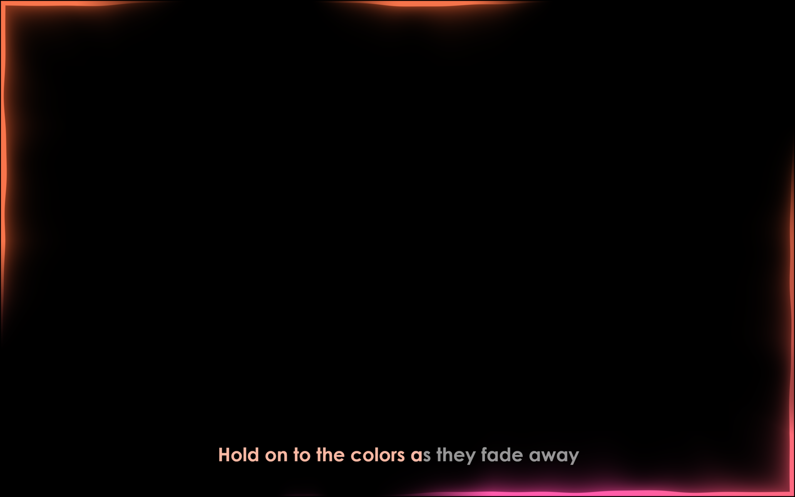
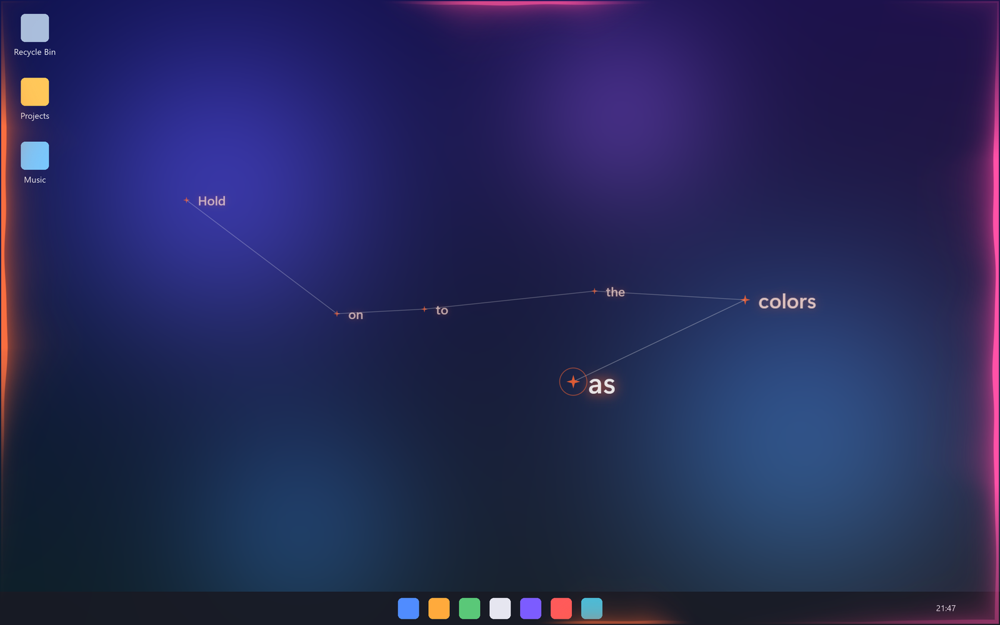
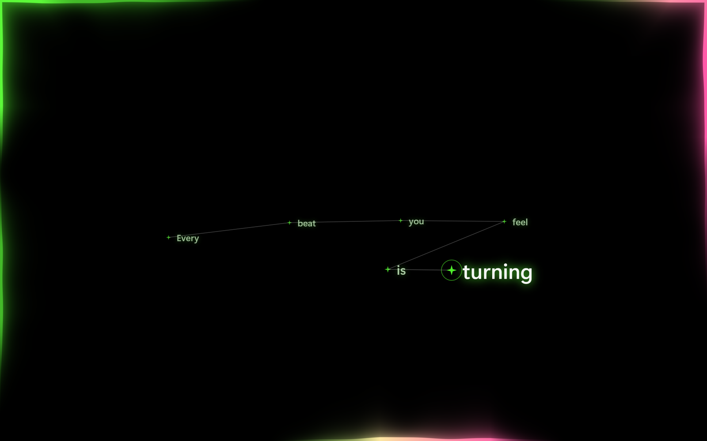
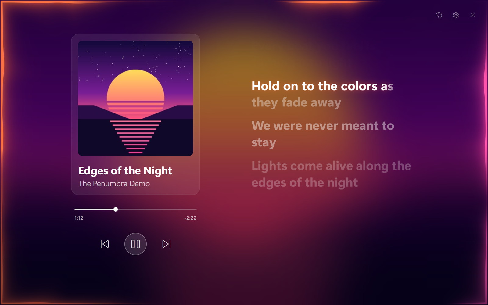
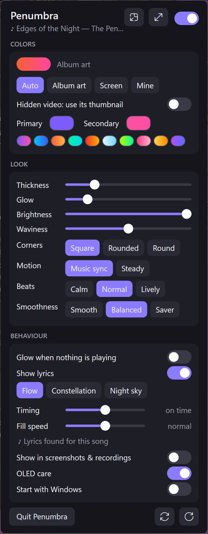

# Penumbra

**An ambient light for the edges of your Windows screen.**
It moves with your music, takes its colors from what you're playing, and can show synced lyrics.

### [⬇ Download for Windows](https://github.com/SadMan-ZaMaN/Penumbra-download/releases/latest)

---

## Install

1. Open the **[latest release](https://github.com/SadMan-ZaMaN/Penumbra-download/releases/latest)** and download **`Penumbra-Setup-<version>.exe`** under **Assets**.
2. Run it. If Windows says **"Windows protected your PC"**, click **More info → Run anyway**. The installer isn't code-signed (signing costs a yearly fee), and that's all the warning means.
3. Click through the installer. Penumbra starts and opens its settings panel. Play some music and the edges light up.

**You need:** 64-bit Windows 10 (version 2004 or newer) or Windows 11, and a graphics card with DirectX 11 (any from the last decade). Nothing else to install: everything Penumbra needs is inside the installer. It installs for your user only, without asking for admin rights.

**Update:** download the newer Setup from the same page and run it. It installs over the old one.
**Uninstall:** Windows **Settings → Apps → Penumbra → Uninstall**.

New to it? The short **[user guide](USER-GUIDE.md)** covers everything: shortcuts, lyrics, the players and what to do if something's not right.

## Features

- **A glow that moves with the music.** A thin, solid line of light hugs the screen edges. Streams of light grow, travel around the edge and fade, with darkness in between. Beats start new streams, and louder music makes them brighter and faster.
- **Colors that match what's playing.** For music (Spotify, YouTube Music…), the glow takes the main color of the album art. For videos (YouTube, VLC…), it follows the colors on screen.
- **Synced lyrics, three ways:**
  - **Flow:** one bold line above the taskbar, karaoke style: a light tint of the song's color fills the letters as they're sung.
  - **Constellation:** each word appears as a star, joined to the last one.
  - **Night sky:** the constellation on a pitch-black screen, with the glow around it.
- **A full-screen Now playing screen.** The cover on a blurred copy of itself, the lyrics scrolling beside it, a progress bar and play controls. The background can be the cover, a color of your choice, or the cover tinted with that color.
- **A mini player.** A small bar that floats over your apps, with the cover, the song, its lyric line filling in, and previous / play-pause / next. Tuck it into the side of the screen when you don't need it.
- **Stays out of your way.** Clicks go straight through the light, it never takes focus, it's hidden from screenshots and screen sharing by default, and it switches itself off when nothing is playing.
- **Light on your PC.** It's drawn on the graphics card and uses about 4–8% of one CPU core while music plays, and almost nothing when it's quiet.
- **A small settings panel** that pops up from the tray icon: colors, thickness, glow, brightness, corners, motion, lyrics and more.

## Screenshots

<table>
<tr>
<td width="50%"> <b>Constellation</b>: the stars float over your desktop; the word being sung is big, earlier ones settle small</td>
<td width="50%"> <b>Night sky</b>: the whole screen goes black while the song plays</td>
</tr>
<tr>
<td colspan="2"> <b>Flow</b>: a light tint of the song's color fills the line as it's sung</td>
</tr>
<tr>
<td colspan="2"> <b>Now playing</b>: the cover, the song and the controls on the left, the lyrics scrolling on the right (a made-up demo song)</td>
</tr>
</table>

### The settings panel

Left-click the ring icon in the tray (next to the clock) and the panel pops up. It shows what's playing and the colors in use right now, and has every setting. Changes show on screen straight away.

 

## Keyboard shortcuts

These work from anywhere, in any app.

| Keys | What it does |
|---|---|
| **Ctrl + Alt + P** | The light on / off (handy for games and video calls) |
| **Ctrl + Alt + N** | Opens or closes the Now playing screen. During Night sky, it lifts the black screen and brings it back. |
| **Ctrl + Alt + M** | Shows or hides the mini player |

## Privacy

- **Sound:** Penumbra listens to what your PC plays, only to find the beat. It's never recorded or saved, and it never uses your microphone.
- **The screen** is looked at as a tiny 64×40 picture, only to pick colors for videos. It's never saved or sent anywhere.
- **Lyrics:** only with **Show lyrics** on, the song's title and artist are sent to [lrclib.net](https://lrclib.net) to find them.
- **Sharp covers:** only while the Now playing screen is open, the title and artist are sent to Apple's iTunes search.
- Nothing else leaves your PC. The only file it saves is its settings (`%APPDATA%\Penumbra\settings.json`).

## Good to know

- **Games:** an always-on-top light can cost a little FPS in full-screen games. Switch it off while gaming with **Ctrl + Alt + P**.
- **OLED screens:** OLED care is on by default. It slowly moves the light a few pixels, so the same pixels don't take all the wear.
- **Private / Incognito browser windows** hide the song's name from Windows, so lyrics can't be found there and colors come from the screen.

## Credits

- Inspired by [Lumn](https://www.trylumn.xyz/), an ambient screen light for macOS. Penumbra is an independent Windows app, not affiliated with it.
- Lyrics come from [LRCLIB](https://lrclib.net), a free lyrics database.
- Penumbra is built with Python, .NET and a few open-source libraries: see [THIRD-PARTY-NOTICES.md](THIRD-PARTY-NOTICES.md).
